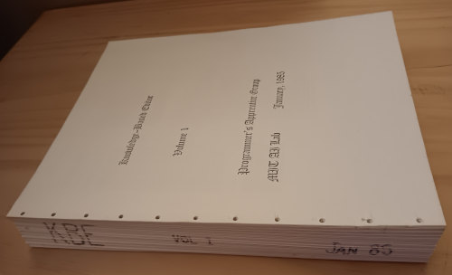
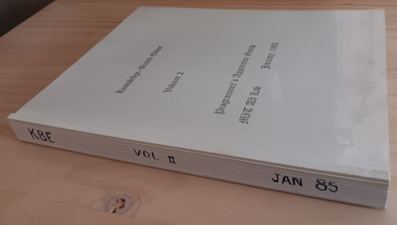
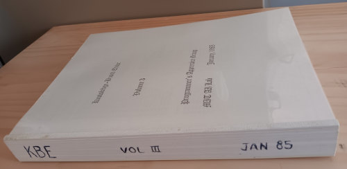
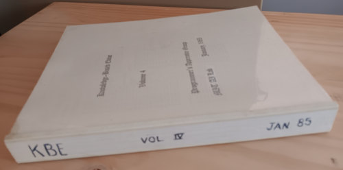

# Knowledge-Based Editor (KBE)

## Overview

After I graduated MIT in 1981, I worked as a research associate on the
Programmer's Apprentice project at the MIT Artificial Intelligence Laboratory.
My task was to create a user interface that ran
on a [CADR Lisp Machine](https://mitmuseum.mit.edu/collections/object/1991.003.002),
integrated with Zmacs, the Lisp Machine variant of Emacs.

The overall tool, the Knowledge-Based Editor (KBE), with its Zmacs integration,
gradually came to be referred to as KBEmacs.

At some point in my work, probably around the time when I was leaving, I made a 
hardcopy source listing for my personal reference, and velobound it. I have subsequently
broken the binding on these paper documents, scanned them, and disposed of the originals
because this entire history archival project is about pressure I am under to reduce physical volume of
stored stuff at my house and the fact that museums are too picky about how they want things packaged and labeled
before they will even look at them. I had assumed museums were about curation, but all the ones I have
talked to seem to be primarily warehouses. As I find myself saying more and more these days, this is how history dies.

&emsp;&mdash;_Kent Pitman_, 13-Oct-2026

* [Knowledge-Based_Editor_Jan-1985_volume_1.pdf](Knowledge-Based_Editor_Jan-1985_volume_1.pdf)\
  

* [Knowledge-Based_Editor_Jan-1985_volume_2.pdf](Knowledge-Based_Editor_Jan-1985_volume_2.pdf)\
  

* [Knowledge-Based_Editor_Jan-1985_volume_3.pdf](Knowledge-Based_Editor_Jan-1985_volume_3.pdf)\
  

* [Knowledge-Based_Editor_Jan-1985_volume_4.pdf](Knowledge-Based_Editor_Jan-1985_volume_4.pdf)\
  

## About the KBE

This was _long_ before the days of the LLM. The detailed mechanisms
were completely different.  Yet there was a surprising similarity of
structure.

The KBE understood programs at what I came to call the "deep
structure" level, by analogy to how linguists often
characterized language understanding back then. 
Programs were represented and manipulated as
logical assertions about data-flow and control-flow arrows that connected
program elements that were conceptually related to the surface
structure, the code, but not in a way that looked the same.

What might in the deep structure be a pipe from a generator of
data to a filter to a collection of final output in a list might be
represented in code using loops that are not simple pipes, that use
ordinary Lisp or PL/1 or Ada variables to hold partial information, 
that do tests interleaved with the generation, not the same modularity at all.

When commands were issued, the program would be converted to its deep
structure, edited there, and then re-coded into surface
structure. This is very like what LLMs do, except their deep structure
is very different.

What made the effect coherent was that the "coder" (the program that
turned deep structure into surface structure) wasn't remarkably
creative in its choice of programming constructs, so similar
deep structure tended to code very similarly in the surface structure
and it often gave the impression that local edits were being made. You
see this effect in LLM-mediated graphics editing sometimes, where the
metaphor might be 'editing' but odd effects occur because really
a new picture is generated from scratch each time; the original is
sometimes not edited in the way humans would think of the term.

Similarly, the KBE was always generating anew. Any sense of surface code
similarity or local editing was a byproduct of changing carried
constraints at the deep structure level and then invoking a coder that
was not sophisticated enough to vary the surface structure hugely. It
was more of a lucky coincidence than a controlled effect.

My impression when watching visiting funders evaluate the system from
demonstrations was that they began unimpressed, lulled into thinking it was just
form-filling using simplistic templates.
Later, however, they perked up when a command was issued saying, 
"Document the program."
This led to a very different rendering of the same code that would
cause observers to stop and do a double-take and invariably, after
a pause, say "Oh, it's smart."

Although it wasn't a scientific sample, I went ahead and personally
inferred from this that they thought "smart" meant
"capable of shifting representations when necessary". I continue to
believe this is the essence of real intelligence. Not the ability to
just operate in one abstraction but the ability to shift fluidly to
others to get better leverage.

Dave Chapman once wrote a coder that noticed subtle changes in
underlying structure that would allow different programming
constructs to be chosen in some nuanced situations.
Unfortunately, the effect was disconcerting because programs changed more
than one expected and might have to change back due to other changes added
by subsequent commands.
My recollection is that we concluded it was best to
save use of the sophisticated coder for the end, and use the dumb coder
incrementally so that small edits seemed more locally coherent.

## Notes on Coding Style

Originally the KBE ran in [Maclisp](https://maclisp.info) on the PDP-10,
so its coding style contains vestigial aspects of that language. By the
time of this listing, the code had been upgraded to run in
[Zetalisp](https://en.wikipedia.org/wiki/Lisp_Machine_Lisp).

Maclisp had no package system, so digits were prepended to names to
keep individual developers' code from clashing with code from other
team members. Functions had names like 2ASSERT or 8ASSERT depending on
whether they were written by someone maintaining 'package' 2 or 8.
When I did the port to the Lisp Machine, most of this ugly prefixing of digits
was stripped out, in favor of using packages.
Very few name conflicts were found.
And if any stray digits remain somewhere,
at least you'll know what they're about.

## Notes on Data Quality

### Completeness

Because this was code, which is unusually intolerant of ordering issues, I manually checked that each page in the original was
present in the scan and in the right order.

My recollection is that there may have been a missing page somewhere in a non-code position, but alas I seem to have misplaced
my notes on that. If you find that a page is missing, I can tell you it's not a scan problem. It's a problem in the original
hardcopy that I saved. Sorry about that.

### Photograph

Sorry the photo of volume 4 is so fuzzy. I didn't notice until too late.

### Scan Resolution

I have higher resolution scan pages available upon request to anyone who wants to do an OCR
with those instead of what's checked in here.

In general, though,
I've not provided high resolution pages here because I've tried to keep the size of this repository in check
so that casual browsing, which is what I expect most people will do, doesn't consume too much disk space.
I'll probably release a separate directory with the higher quality scans at another time.
If you need something sooner,
[contact me](https://nhplace.com/kent/contact-kent.html).

#### Jeff Shrager's KBEmacs restoration effort

In a surprising coincidence, [Jeff Shrager](https://github.com/jeffshrager) recently contacted me
to inquire if I had sources to this program, which I scanned just weeks before into PDF.
In a matter of hours, I was able to get him what he needed and he proceeded ahead on a restoration
project of his own. With the help of an LLM ([specifically Claude Opus 5.5](https://github.com/jeffshrager/kbemacs/commit/b86d85a73c902fff58465d2519ad3d6511b32939)), Jeff
got the sources OCR'd and a headless version of this system running in
[Steel Bank Common Lisp (SBCL)](https://www.sbcl.org/)&mdash;enough to run some examples. (Thanks, Jeff!)

So if you're wanting to do your own experimentation, you might be able to start from what he's done.

Various tags in Jeff's repo are available here as
git submodules at [`RESTORATIONS/JeffShrager/`](RESTORATIONS/JeffShrager/).
Individual tags represent the state of his work at particularly named times
corresponding to tags in [his kbemacs repo](https://github.com/jeffshrager/kbemacs),
such as
[initial_OCR_unchecked](RESTORATIONS/JeffShrager/initial_OCR_unchecked/)
and
[headless_SQRT_functional](RESTORATIONS/JeffShrager/headless_SQRT_functional/).

Note that when you do a plain `git clone ...`, the submodule directories will be empty.
You will need to either use this to check things out:

    git clone --recurse-submodules ...

or else repair the checkout later with:

    git submodule update --init

Note that I have linked these tags in Jeff's repo for historical reasons here,
but if you have ongoing interest in developing something, I recommend just 
separately cloning his repo and working with him directly,
as the function of this repo is primarily to be a historical snapshot.
I don't plan to track ongoing development.

## References

* _KBEmacs: A Step Toward the Programmer's Apprentice_\
   by Richard C. Waters\
   [MIT AI Technical Report No. 753 (TR-753)](https://dspace.mit.edu/entities/publication/5c4cf30b-84c1-4636-97a1-d322fb978b98),
   May 1985.

* _Interfacing to the Programmer's Apprentice_\
  by Kent Pitman\
  [MIT AI Working Paper 244 (WP-244)](https://dspace.mit.edu/entities/publication/1b08e55b-5607-4046-84d2-81026533e62f),
  February 1983.

Several other papers are available at [MIT's DSpace](https://dspace.mit.edu) with the search keyword "KBEmacs".

## Notes on Copyright and License

### License Notes

It's not my place to be retroactively creating additional license information
for these files, so I'll just note what I learned by case-insensitive search
in this historical data for the word "copyright".

 * **Copyright Owner.**
   Many files contain explicit MIT copyright claims for 1983, 1984, or 1985.
   The form of these notices varies slightly, sometimes using the form
   "(c) Copyright 1983" and sometimes just "(c) 1983", but in all cases 
   "Massachusetts Institute of Technology" is cited as the copyright owner.

   A number of source files omit any notice.

 * **License.**
   In all but two cases where there is an MIT copyright, there is an assertion
   of this early MIT license, which was more commercially restrictive than the
   modern permissive license most people are familiar with:

       All Rights Reserved.
       Permission to copy all or part of this material is granted,
       provided that the copies are not made or distributed for resale,
       the MIT copyright notice and reference to the source file and
       the software distribution version appear, and that notice is
       given that copying is by permission of Massachusetts Institute
       of Technology.

 * Two artifact files contain an MIT copyright but not an
   explicit mention of any license; 
   they are files that seem to be for the
   purpose of demonstrating behavior of the overall system.
   I am assuming that this was a
   brevity issue, not a change in intellectual property scheme from
   any prevailing or default license. But, of course, I cannot assert that
   with any legal authority.

   * `demo-lib.lisp` (in volume 3)
   * `demo-ada-lib.lisp` (in volume 3)
  
### My decision to post this material

Based on the above, I personally concluded that there was no compelling reason
not to post this data publicly as part of a historical record.
It seemed either expressly intended or a reasonable inference that the
aforementioned commercially restrictive MIT license applies to the 
entire code base. Although some files lack
copyright notices and/or license notices, the ones that use a notice are 
consistent.

Also, and importantly, I don't see any indication that MIT even wants to
revive or display this data, much less make money on it, nor am I sure how they could.
Not being able to afford to talk to a lawyer about this,
I have to rely on my lay reading of the fair use doctrine.
But it seems to suggest
I should care about the economic impact on them, and as far as I can tell
(since I've seen no obvious interest over a period of many decades,
and they may not have even bothered to retain copies of these files at all),
I have to conclude that the level of economic interest and impact on them is zero.
Also, of course, I'm not making money doing this.
No one is stepping up to pay for any of this so far, so I myself am losing money
by doing this instead of seeking gainful employment.
I just think history matters.

Even so, I cannot speak with 
authority on legal interpretation; I'm just documenting my own
contemporaneous reasoning.
Anyone using this data will need to form their own conclusion.

The principal investigators on this project were
[Charles Rich](https://web.archive.org/web/20180117060521/https://web.cs.wpi.edu/~rich/)
and 
[Richard Waters](https://web.archive.org/web/20240723042415/http://rcwaters.org/), my
former supervisors in my work on the user interface for the Programmer's Apprentice project.
[Charles Rich passed away in 2018](https://www.wpi.edu/news/memoriam-charles-rich-computer-science-professor-and-artificial-intelligence-pioneer),
and I was unable to reach Waters when I sent
him email in June 2026,
so I got no additional guidance there.

If anyone with legal standing thinks these works should not be public, they can
[contact me](https://nhplace.com/kent/contact-kent.html).

### Original funding of the work

MIT AI Technical Report No. 753 (TR-753), "KBEmacs: A Step Toward the
Programmer's Apprentice" by Richard C. Waters, has the following
notice about funding of the project, which may be of some historical
interest and/or legal relevance in construing copyright:

    This report describes research done at the Artificial Intelligence
    Laboratory of the Massachusetts Institute of Technology. Support
    for the laboratory's artificial intelligence research has been
    provided in part by the Advanced Research Projects Agency of the
    Department of Defense under Office of Naval Research contract
    N00014-80-C-0505, in part by National Science Foundation grants
    MCS-7912179 and MCS-8117633, and in part by the IBM Corporation.
