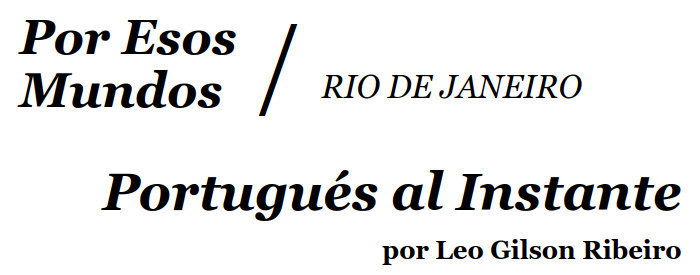

**A historical restoration of...**

## Overview

The subject matter of this restoration project is an article titled
"Portugués al Instante" by Leo Gilson Ribeiro, published several
decades ago.  I can find no record of it on the web now, but it was
long ago personally important to me. So I've tried to preserve it.

In the process, I had to repair it because I had a poor quality
photocopy (see details below and in the repaired document itself, or
see the scan I made of the original I was working with.

I enlisted LLM help (Claude Opus 4.8 and Claude Opus 5.5 via
abacus.ai) in order to accomplish this.\
 --Kent Pitman, 2026-11-03

## Provenance

[portugues_al_instante.scanned.600dpi.pdf](portugues_al_instante.scanned.600dpi.pdf)
is a 600dpi scan of an article by Leo Gilson Ribeiro,
originally published in Spanish.
Beyond that I know nothing of its origin.

I only know that I obtained this poorly made photocopy of the article
from a linguistics professor at MIT when I visited him in 1981 to ask
for help learning Portuguese quickly, given that I knew Spanish
already. This article had been waiting patiently in a nearby file
cabinet for me to ask that question.

The copy I received was worn along the lines where it was folded, and
some text was lost to those creases. Since that time, I have searched
in vain for a more authoritative webbed version, and to date I have
not found one.  If anyone knows of one, please let me know and I'll
link it from here.

## Methodology

Filling in the gaps at each of the cut-off or smudged points you can
see in the scan took several long days of painstaking work with Claude
Opus 4.8 and Claude Opus 5.5 at [abacus.ai](abacus.ai).

Long ago (2006), I had typed in the paper's text for a friend of mine
who was blind, notating the gaps and not trying to fill many of
them. This time we started from a scan and an LLM OCR that was
imperfect, so we used my hand-typed version to find discrepancies that
were then visually checked against the original.

Much time was spent debating what the best interpretation of some
partial information was, and then creating a document that contained
annotations in brackets for things we were fixing. But this version was
ugly to look at. It also located a number of discrepancies just by noticing
semantic irregularities and asked me to check against the scans.

I proposed to Claude that we move from a .md representation, which it
had chosen, to HTML, and that we add Javascript that allowed us to
show or hide the annotations. I specified the various CSS styles we
would need in order to capture the different kinds of annotation, and
the functions that would be needed to move between the two modes. By
this time I had upgraded from Claude Opus 4.8 to Claude Opus 5.5.

Claude Opus 5.5 was quite good at implementing what I specified.  So
my idea, my data representations and code structure, and its
implementation.  A pretty efficient division of labor.

When we were close to done, I did a careful read of the rendered work
against the physical document and we found a couple more
discrepancies, which we then repaired.

I've included here the high quality scan (600dpi, which I suspect is
higher quality than the original printing). I think this level of
quality is essential because every little bit of ink helps in
disambiguation.  The result is the file
[portugues_al_instante.html](portugues_al_instante.html) in this same
directory.\

## Intellectual property

The original work, which I scanned as
[portugues_al_instante.scanned.600dpi.pdf](portugues_al_instante.scanned.600dpi.pdf)
in this directory, remains the intellectual property of its author
and/or its publisher. I have no information regarding this.  Given
this lack of information, and to ensure the text would not be lost, I
decided to undertake the project of reconstructing the document in the
form presented here as
[portugues_al_instante.html](portugues_al_instante.html).

What I have added in preparing 
[the reconstructed artifact](portugues_al_instante.html) is\
Copyright &copy; 2026 Kent M. Pitman\
and I offer it to the public under a
[Creative Commons BY-NC 4.0](https://creativecommons.org/licenses/by-nc/4.0/)
license so that good work doen't get lost.
According to my own (non-lawyerly) interpretation,
this constitutes fair use for the purpose of historical preservation.

You will have to decide for yourself whether the uses you intend to
make of the work as a whole are legally appropriate.
